<!-- ═══════════════════════ HEADER ═══════════════════════ -->
<p align="center">
  
</p>

<p align="center">
  
</p>

<p align="center">
  
  
  
</p>

<p align="center">
  
  
  
</p>

<p align="center"></p>

## 🌸 Expediente de Piloto · `CODE: 016`

<table>
<tr>
<td width="55%" valign="top">

```yaml
piloto:     Alejandro
alias:      amartinhit2
base:       Plantation 13 · Navarra
unidad:     Squad 13 · 13.ª División del Gotei 13
franxx:     Strelizia (pareja: Code 002)
zanpakuto:  Zangetsu.java
shinigami:  Sustituto
espada:     Colosal
mision:     Backends que resisten a cualquier Klaxosaur
estado:     Sincronizacion estable
```

</td>
<td width="45%" valign="top" align="center">


> *"Un piloto no lucha solo:*
> *su código es su pareja."*

</td>
</tr>
</table>

<p align="center"></p>

## ⚔️ Zanpakutō · Arsenal

<p align="center"><b>🗡️ SHIKAI — Backend</b></p>
<p align="center">
  
</p>

<p align="center"><b>🔥 BANKAI — Juegos y móvil</b></p>
<p align="center">
  
</p>

<p align="center"><b>🎴 KIDŌ — Front-end y herramientas</b></p>
<p align="center">
  
</p>

<p align="center">
  
  
  
</p>

<p align="center"></p>

## 🤖 Hangar de Franxx · Proyectos

<p align="center"><b>⚡ UNIDADES DESPLEGADAS — Repos públicos</b></p>

<p align="center">
  <a href="https://github.com/amartinhit2/Katanime-NuvioExtension">
    
  </a>
  <a href="https://github.com/amartinhit2/Tetris">
    
  </a>
</p>

<table align="center">
<tr>
<td align="center" width="50%">
<h3>📺 Katanime × Nuvio</h3>
<sub>Extensión para Nuvio y Stremio: catálogo<br/>de Katanime con streams desde MEGA.<br/>v1.2.0 con escudo anti-Abuso y Funnel.</sub><br/><br/>


</td>
<td align="center" width="50%">
<h3>🧱 Tetris</h3>
<sub>El clásico de bloques<br/>directo en el navegador.<br/>Encaja la pieza, limpia la fila.</sub><br/><br/>


</td>
</tr>
</table>

<p align="center"><b>🔒 UNIDADES CLASIFICADAS — Repos privados</b></p>

<table align="center">
<tr>
<td align="center" width="25%">
<h3>🌑 Hueco Mundo</h3>
<sub>Top-down en pixel art<br/>mundo oscuro y rocoso</sub><br/><br/>


</td>
<td align="center" width="25%">
<h3>🌋 Isla del Volcán</h3>
<sub>Juego 3D<br/>¡Llega a la meta!</sub><br/><br/>


</td>
<td align="center" width="25%">
<h3>🏠 Web tipo Airbnb</h3>
<sub>Plataforma de alojamientos<br/>con APIs externas</sub><br/><br/>


</td>
<td align="center" width="25%">
<h3>⚙️ Javalin Core</h3>
<sub>Backend a gran escala<br/>con plantillas</sub><br/><br/>

</td>
</tr>
</table>

<p align="center"></p>

## 📊 Nivel de Reiatsu

<p align="center">
  
  
</p>

<p align="center">
  
</p>

<p align="center">
  
  
  
  
  
  
</p>

<p align="center">
  
</p>

## 🐍 Klaxosaur devorando mis commits

<p align="center">
  
</p>

<p align="center"></p>

## 🎌 Código de honor del Shinigami

```diff
+ Cada bug es un Hollow: se purifica, no se ignora.
+ Un commit limpio vale más que mil líneas sin sentido.
+ Sincroniza con tu equipo como Hiro y 002 en el Strelizia.
+ Persiste como Ichigo: si hay que entrar al Hueco Mundo, se entra.
+ Lucha como Guts: aunque llegue el eclipse, sigues blandiendo la espada.
+ Aprende el nombre de tu Zanpakutō: es el primer paso hacia el Bankai.
- Nunca hagas push a main un viernes por la noche.
```

## 🌸 Frecuencia del Alma

<p align="center">
  
</p>

<p align="center">
  
</p>

<p align="center">
  
</p>

<p align="center">
  
  
  
  
  
</p>

<p align="center">
  
  
  
  
  
</p>

<p align="center">
  
  
  
</p>

<p align="center">
  
</p>

<p align="center">
  
</p>

<p align="center">
  
</p>


